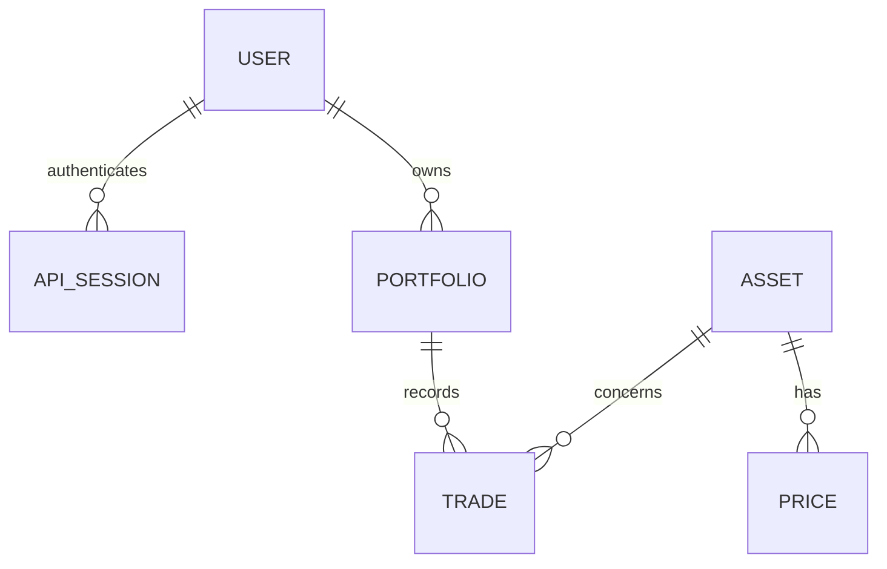

# Modélisation de l’API de portefeuilles

## Besoin et hypothèses

Consigne reçue : « modélisation API gestion de portefeuille avec Ruby on Rails ».
Le contexte de candidature conduit à retenir des portefeuilles d’investissement.
Ce périmètre constitue une proposition du candidat, et non une spécification de WeSave.

La première version métier cible des investissements en EUR, sans vente à découvert,
sans frais ni fiscalité, sans import de cours externes. Les cours sont renseignés
manuellement. L’objectif est de démontrer une API cohérente et testable.

## Modèles implémentés

| Modèle | Attributs principaux | Relations |
| --- | --- | --- |
| User | email, password_digest | possède plusieurs portfolios |
| ApiSession | user_id, token_digest, expires_at | appartient à un user |
| Portfolio | user_id, name, currency | appartient à un user ; possède plusieurs trades |
| Asset | isin, name, asset_type | possède plusieurs prices et trades |
| Trade | portfolio_id, asset_id, side, quantity, unit_price, executed_at | appartient à un portfolio et un asset |
| Price | asset_id, value, quoted_on | appartient à un asset |

`Trade` évite le nom `Transaction`, déjà employé par Active Record.
Les positions sont calculées ; aucune table Position ne duplique les quantités.
La trésorerie existante (`Wallet`, `Operation`) est un prototype distinct : son
intégration à un portefeuille sera explicite si les achats doivent débiter un solde.
Elle ne doit pas être assimilée à la valeur des investissements.

## Règles métier

- Une position = somme des quantités achetées moins somme des quantités vendues.
- Une vente ne peut dépasser la quantité disponible à sa date d’exécution.
- Les opérations antidatées doivent aussi préserver les positions futures :
  valider la chronologie complète de l’actif dans le portefeuille.
- Une écriture de trade verrouille le portefeuille et valide les quantités dans
  la même transaction SQL, afin de sérialiser les achats et ventes concurrents.
- Quantité : decimal(24, 8). Prix unitaire et cours : decimal(24, 8).
  Valeur affichée : arrondie à deux décimales à la fin du calcul.
- Quantité, prix unitaire et cours sont strictement positifs et finis.
- Un ISIN est unique ; un cours est unique par actif et date.
- Les cours futurs et les transactions futures sont refusés dans ce périmètre.
- Une valorisation à une date utilise les trades exécutés jusqu’à cette date
  et le dernier cours connu à cette date pour chaque actif détenu.
- Si un cours manque, l’API indique les actifs manquants et une valeur totale
  indisponible ; elle ne présente pas un total partiel comme un total complet.
- La plus-value latente et la performance sont hors périmètre initial : elles
  demandent une convention de coût et une prise en compte des flux explicites.
- L’utilisateur ne peut lire ou modifier que ses propres portefeuilles.
- Les trades ne sont pas modifiables ou supprimables dans la première version.

## Contrat HTTP

| Méthode | Route | Fonction |
| --- | --- | --- |
| POST | /api/v1/users | Inscription |
| POST | /api/v1/session | Connexion |
| DELETE | /api/v1/session | Déconnexion |
| GET, POST | /api/v1/portfolios | Liste paginée et création |
| GET | /api/v1/portfolios/:id | Consultation |
| GET, POST | /api/v1/portfolios/:id/trades | Historique paginé et achat/vente |
| GET | /api/v1/portfolios/:id/positions | Quantités détenues |
| GET | /api/v1/portfolios/:id/valuation?date=YYYY-MM-DD | Valorisation à une date |
| GET | /api/v1/assets | Catalogue paginé |
| GET | /api/v1/assets/:id/prices | Historique des cours |

Le catalogue et les cours sont alimentés par seeds pour la démonstration ;
aucune écriture publique n’est nécessaire sur ces ressources.
Les listes sont bornées et paginées. Les décimaux sont sérialisés en chaînes.
Les créations renvoient 201 ; les erreurs de validation 422 ; l’absence de
connexion 401. Une ressource absente ou appartenant à un autre utilisateur
renvoie 404. Les paramètres manquants ou mal formés renvoient 400.

## Vérifications automatisées

Tests de requêtes pour l’authentification et l’isolation des utilisateurs ;
achat puis vente partielle ; rejet d’une vente excessive ; précision décimale ;
rejet des valeurs invalides ; chronologie des trades ; valorisation historique ;
cours absent ; test concurrent avec deux ventes dépassant ensemble la position.
Contraintes SQL : clés étrangères, NOT NULL, index uniques et CHECK sur les
montants positifs et le sens des trades.

## État de l’implémentation

Rails API, Docker Compose, PostgreSQL et Makefile sont disponibles.
Les modèles et routes d’investissement décrits ici sont implémentés et testés.
Le prototype de trésorerie ne dispose plus de routes publiques ; ses tables sont
conservées pour préserver les éventuelles données locales existantes.
Les sessions utilisent des jetons Bearer aléatoires valables 24 heures ; seule
leur empreinte SHA-256 est stockée. La déconnexion révoque le jeton.
