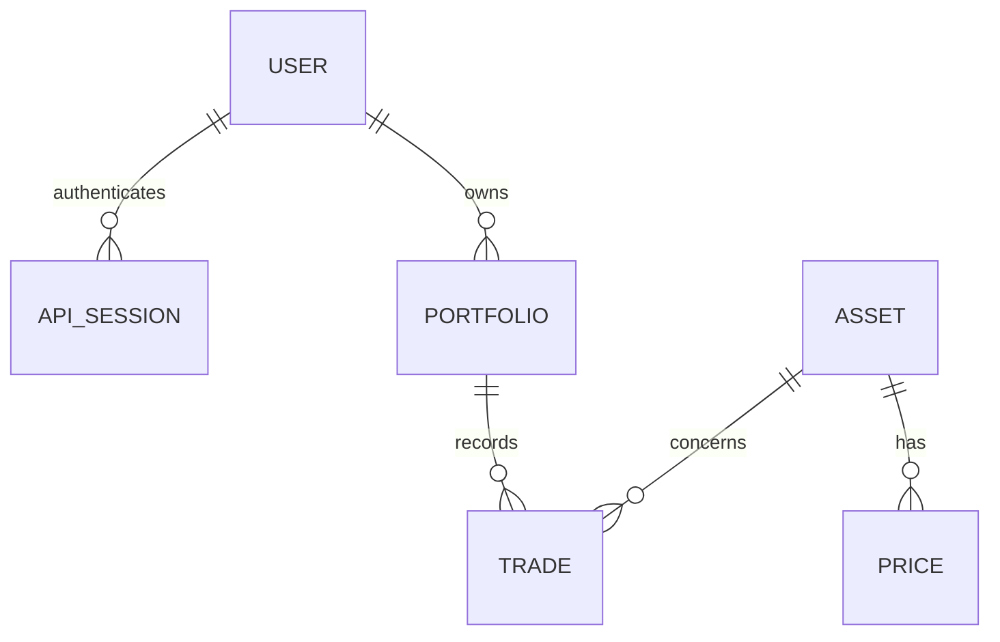

# Modélisation de l’API de portefeuilles

## Besoin et hypothèses

La consigne est ouverte : « modélisation API gestion de portefeuille avec Ruby on Rails ».
Le projet retient des portefeuilles d’investissement, en lien avec l’activité de
WeSave. Cette interprétation reste à confirmer avec l’entreprise.

Cette version gère des investissements en EUR. Elle permet d’enregistrer des
achats et des ventes, de consulter les quantités détenues et de calculer leur
valeur à une date donnée. Les frais, la fiscalité et les ventes à découvert ne
sont pas pris en charge. Les cours de démonstration sont fictifs, sans connexion
à un fournisseur de données financières.

## Modèles

| Modèle | Attributs principaux | Relations |
| --- | --- | --- |
| User | email, password_digest | possède plusieurs portfolios |
| ApiSession | user_id, token_digest, expires_at | appartient à un user |
| Portfolio | user_id, name, currency | appartient à un user ; possède plusieurs trades |
| Asset | isin, name, asset_type | possède plusieurs prices et trades |
| Trade | portfolio_id, asset_id, side, quantity, unit_price, executed_at | appartient à un portfolio et un asset |
| Price | asset_id, value, quoted_on | appartient à un asset |



`Trade` désigne un achat ou une vente. Ce nom évite la confusion avec les
transactions de base de données utilisées par Active Record.

Les positions sont calculées depuis les achats et ventes. Par exemple, un achat
de 10 parts suivi d’une vente de 3 parts donne une position de 7 parts. Une table
supplémentaire de positions obligerait à maintenir ces deux sources en cohérence.

La gestion des espèces est hors périmètre : enregistrer un achat ne débite pas
un compte bancaire.

## Calculs et règles métier

- Une position = somme des quantités achetées moins somme des quantités vendues.
- Une vente ne peut dépasser la quantité disponible à sa date d’exécution.
- Un achat ou une vente antidaté ne doit pas rendre une position négative à un
  autre moment de l’historique. La validation parcourt donc toute la chronologie
  de l’actif dans le portefeuille.
- Le portefeuille est verrouillé pendant l’enregistrement, avec une nouvelle
  validation sous verrou. Par exemple, si deux requêtes vendent chacune 7 parts
  alors que le portefeuille en contient 10, une seule doit être acceptée.
- Quantité : decimal(24, 8). Prix unitaire et cours : decimal(24, 8).
  Valeur affichée : arrondie à deux décimales à la fin du calcul.
- Quantité, prix unitaire et cours sont strictement positifs et finis.
- Un ISIN est unique ; un cours est unique par actif et date.
- Les cours futurs et les transactions futures sont refusés dans ce périmètre.
- Une valorisation à une date utilise les trades exécutés jusqu’à cette date
  et le dernier cours connu à cette date pour chaque actif détenu.
- Si un cours manque, l’API indique les actifs manquants et une valeur totale
  indisponible ; elle ne présente pas un total partiel comme un total complet.
- La plus-value latente et la performance sont hors périmètre initial : elles
  demandent une convention de coût et une prise en compte des flux explicites.
- L’utilisateur ne peut lire ou modifier que ses propres portefeuilles.
- Les trades ne sont pas modifiables ou supprimables dans la première version.

## Contrat HTTP

| Méthode | Route | Fonction |
| --- | --- | --- |
| POST | /api/v1/users | Inscription |
| POST | /api/v1/session | Connexion |
| DELETE | /api/v1/session | Déconnexion |
| GET, POST | /api/v1/portfolios | Liste paginée et création |
| GET | /api/v1/portfolios/:id | Consultation |
| GET, POST | /api/v1/portfolios/:id/trades | Historique paginé et achat/vente |
| GET | /api/v1/portfolios/:id/positions | Quantités détenues |
| GET | /api/v1/portfolios/:id/valuation?date=YYYY-MM-DD | Valorisation à une date |
| GET | /api/v1/assets | Catalogue paginé |
| GET | /api/v1/assets/:id/prices | Historique des cours |

Le catalogue et les cours sont chargés avec `make seed`. Ils sont consultables
par l’API, mais leur modification n’est pas exposée.
Les listes de portefeuilles, d’opérations, d’actifs et de cours sont limitées à
50 résultats par requête, avec un paramètre `offset`. La liste des positions est
complète. Les montants et quantités sont renvoyés sous forme de chaînes décimales.
Les créations renvoient 201 ; les erreurs de validation 422 ; l’absence de
connexion 401. Une ressource absente ou appartenant à un autre utilisateur
renvoie 404. Les paramètres manquants ou mal formés renvoient 400.

## Authentification et accès

La connexion fournit un jeton Bearer aléatoire, valable 24 heures. La base ne
conserve que son empreinte SHA-256 ; la déconnexion supprime la session.
Les mots de passe sont hachés avec bcrypt.

Chaque accès à un portefeuille passe par les portefeuilles de l’utilisateur
connecté. Un identifiant appartenant à un autre utilisateur renvoie donc 404,
même s’il existe en base.

L’environnement Docker fourni sert à la démonstration locale. Les limites de
sécurité avant une mise en production sont détaillées dans le [README](../README.md).

## Tests et contraintes de base de données

Les tests couvrent la connexion, l’expiration et la révocation des sessions,
l’accès aux portefeuilles d’un autre utilisateur, les achats et ventes, les
montants invalides et la valorisation historique. Un test lance deux ventes
concurrentes pour vérifier qu’elles ne peuvent pas dépasser la position disponible.

Les clés étrangères, les champs obligatoires, les index uniques et les contraintes
SQL sur les valeurs positives complètent les validations Rails.

Pour lancer les vérifications :

```sh
make check
```

Le [README](../README.md) décrit le démarrage, le compte de démonstration et un
parcours de test dans Swagger.
